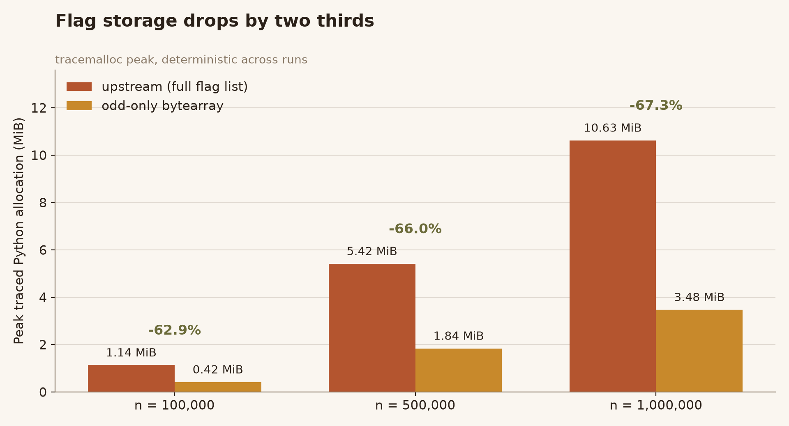
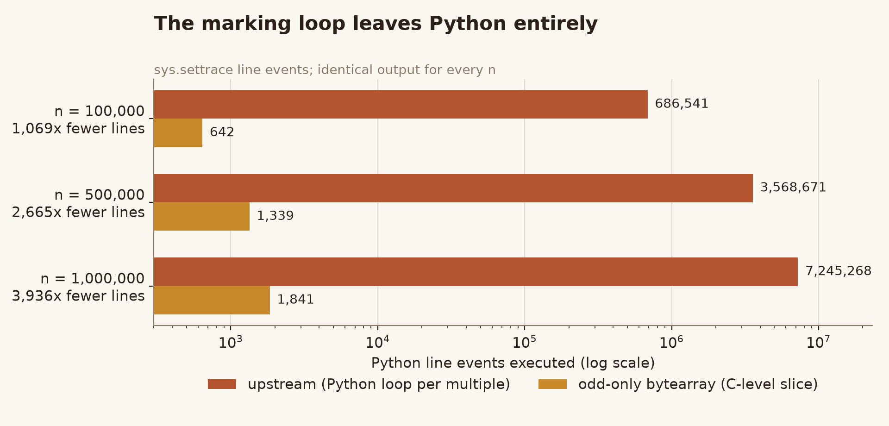
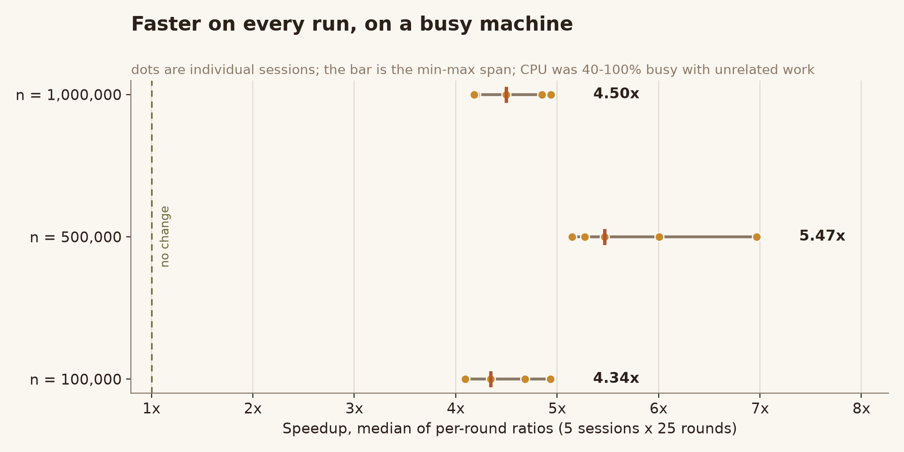

# prime-sieve-perf

An odd-only `bytearray` sieve of Eratosthenes: **4–5x faster** and **63–67% less peak memory** than the classic full flag table, with byte-identical output.

Derived from [`TheAlgorithms/Python`](https://github.com/TheAlgorithms/Python) `maths/sieve_of_eratosthenes.py`. Same function name, same signature, same doctests — a drop-in replacement.



## The change

The upstream version keeps one Python list slot per integer from `0` to `n`, then walks every multiple of every prime in a Python-level loop:

```python
sieve = [True] * (num + 1)
for i in range(start * start, num + 1, start):
    if sieve[i] is True:
        sieve[i] = False
```

Three things move:

1. **Only odd candidates are stored.** Index `i` means the odd number `2i + 3`, so the flag array is about half as long.
2. **Flags are bytes, not pointers.** A `bytearray` holds one byte per candidate instead of one eight-byte list slot.
3. **The marking loop runs in C.** `sieve[start::p] = b"\x00" * mark_count` hands the whole progression to `bytearray` slice assignment; Python never enters a per-multiple loop.

Complexity is unchanged — both are `O(n log log n)`. Only the constant factors move.



That second chart is the mechanism, measured with `sys.settrace` line events. At `n = 1,000,000` the upstream version executes **7,245,268 Python statements** and the optimized one executes **1,841** — the per-multiple work is no longer interpreted at all. This is a deterministic count, so it does not move with CPU load.

## Numbers

Measured on CPython 3.13.12 / Windows, 5 independent sessions × 25 interleaved rounds per size. Speedup is the median of per-round ratios; the bracket is the spread across sessions.

| n | primes | upstream | optimized | speedup | peak traced allocation |
|---:|---:|---:|---:|---:|---:|
| 100,000 | 9,592 | 9.4–12.5 ms | 2.0–3.1 ms | **4.34x** (4.09–4.93) | 1.14 → 0.42 MiB (**−62.93%**) |
| 500,000 | 41,538 | 72.1–108.8 ms | 14.1–15.6 ms | **5.47x** (5.15–6.97) | 5.42 → 1.84 MiB (**−66.01%**) |
| 1,000,000 | 78,498 | 157.4–248.3 ms | 28.8–48.7 ms | **4.50x** (4.18–4.94) | 10.63 → 3.48 MiB (**−67.29%**) |



**Read the memory column as exact, the time column as a range.** `tracemalloc` peaks are deterministic here: reruns land on the same byte count, and an earlier independent measurement on Linux/CPython 3.13.5 matched to within 8 bytes. Wall-clock times were taken on a shared workstation while unrelated services held 40–100% CPU, which inflates absolute times and widens the spread — the ratio stays usable because the two arms alternate every round.

The speedup is larger at 500,000 than at the two neighbouring sizes. That is reproducible across all five sessions rather than noise: at that size the upstream flag list crosses out of cache while the `bytearray` still fits, so memory pressure is doing extra work for the baseline.

## Correctness

Output equality is checked five ways, each independent of the other:

| Check | Coverage |
|---|---|
| Exhaustive comparison | every `n` in `0..6000`, including the `n <= 0` error message |
| Boundary sweeps | `k² − 2 … k² + 2` for `k = 2..1199`, and `2^k − 1 … 2^k + 1` |
| Random inputs | 60 values up to 3,000,000, every returned prime re-verified with Miller–Rabin |
| Published `pi(x)` | 4, 25, 168, 1,229, 9,592, 78,498, 664,579 at `10 … 10⁷` |
| Slice arithmetic | for every `n <= 2,000,000` and every prime `p <= √n`: `mark_count == len(range(start, candidate_count, p))` |

The last one matters most. If `mark_count` is ever off by one, the extended-slice assignment silently **resizes** the `bytearray` instead of overwriting in place, and every index after that point is wrong — with no exception raised. Random testing almost never hits it; checking the identity directly does.

`tests/test_sieve.py` also carries two structural guards, because every behavioural test above passes just as happily when the optimization is removed entirely:

- the source must contain `bytearray` and `isqrt`, and must not contain `sieve = [True]`;
- peak traced allocation at `n = 200,000` must stay below half of the baseline's.

## Reproduce

Python 3.9+. No third-party packages.

```bash
python -m unittest discover -s tests -v            # 8 tests
python scripts/verify_equivalence.py --identities  # deep check, ~10 minutes
python scripts/check_delivery.py                   # line endings + patch consistency
python benchmarks/benchmark_sieve.py --sizes 100000,500000,1000000 --runs 25
python benchmarks/work_count.py --sizes 100000,500000,1000000
python assets/make_figures.py                      # regenerate the charts from JSON
```

`benchmark_sieve.py` accepts `--stat min` for best-of-N, `--aa` for a noise-floor control that compares the baseline against a byte-identical copy of itself, and `--quick` for a smoke run that writes `*_quick.json` so it cannot overwrite the real results.

## Files

```
maths/sieve_of_eratosthenes.py              optimized module (drop-in)
upstream_snapshot/maths/…                   baseline, verbatim apart from line endings
patches/odd_only_bytearray.patch            the diff, applies cleanly to the snapshot
tests/test_sieve.py                         behavioural + structural tests
benchmarks/benchmark_sieve.py               paired timing and memory
benchmarks/work_count.py                    deterministic Python line-event count
benchmarks/results.json                     every raw sample from five sessions
scripts/make_patch.py                       regenerate the patch from the two modules
scripts/verify_equivalence.py               the five-way correctness check
scripts/check_delivery.py                   line endings and patch consistency
assets/make_figures.py                      renders the three charts from results.json
```

## Caveats

- One machine, one Python build. Re-measure on your target before quoting a number.
- These are single-run medians over 25 interleaved rounds, not a controlled benchmark rig. `--aa` exists so you can measure your own noise floor.
- If the goal is an upstream pull request: `TheAlgorithms/Python` is a teaching repository and weighs readability heavily. The version here is defensible (it is commented and the identity above is checkable), but expect a maintainer to ask whether a constant-factor win justifies the extra indirection.

## License and provenance

MIT, same as upstream. `upstream_snapshot/` is the upstream file with CRLF normalized to LF and nothing else changed — see `SOURCE_NOTES.md` for the exact blob and the verification command. Modifications are listed in `NOTICE.md`.
